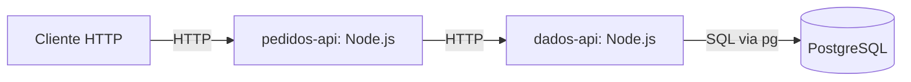
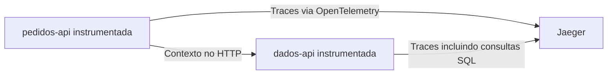
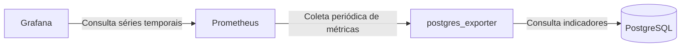

# Arquitetura planejada

## Estado e propósito

Este documento descreve a arquitetura a implementar, não um ambiente em funcionamento. Na Etapa 1 existem somente pastas e documentação. O propósito é observar um problema N+1 real no PostgreSQL e comparar sua execução com uma consulta usando JOIN.

## Responsabilidades e comunicação

As respostas percorrem o caminho inverso. Os dois serviços de aplicação terão processos separados e comunicação HTTP, permitindo acompanhar uma requisição entre serviços.

| Componente | Responsabilidade planejada |
| --- | --- |
| pedidos-api | Receber as requisições públicas, chamar a dados-api e retornar a resposta ao cliente. |
| dados-api | Executar consultas SQL com `pg` e devolver os dados à pedidos-api. |
| PostgreSQL | Persistir clientes e pedidos e executar as consultas das duas implementações. |
| OpenTelemetry | Instrumentar as aplicações e propagar o contexto de rastreamento nas chamadas HTTP. |
| Jaeger | Receber e permitir inspecionar traces distribuídos. |
| postgres_exporter | Expor métricas obtidas do PostgreSQL para coleta. |
| Prometheus | Coletar e armazenar as séries temporais expostas pelo exporter. |
| Grafana | Consultar o Prometheus e apresentar indicadores em painéis. |
| pg_stat_statements | Manter estatísticas agregadas das consultas executadas no PostgreSQL. |
| Docker Compose | Orquestrar os contêineres e sua comunicação no ambiente didático. |

O acesso ao banco ficará concentrado na `dados-api`. A `pedidos-api` não executará SQL diretamente. Portas, rotas internas, timeouts e tratamento de falhas HTTP serão definidos na Etapa 3.

## Caminhos lento e otimizado

Os contratos públicos planejados são:

- `GET /pedidos/lento?limit=100`: a dados-api busca os pedidos e executa uma consulta de cliente para cada pedido retornado. Para N pedidos, são 1 + N consultas SQL de recuperação dos dados.
- `GET /pedidos/otimizado?limit=100`: a dados-api recupera os mesmos pedidos e seus clientes com uma consulta usando JOIN.

O N+1 será produzido no acesso ao banco dentro da `dados-api`; não é necessário realizar uma chamada HTTP entre serviços para cada pedido. O desenho do serviço de dados deverá permitir selecionar cada caminho em uma chamada HTTP.

As implementações deverão devolver os mesmos registros e a mesma estrutura JSON, com ordenação estável. A comparação deverá usar o mesmo limite, conjunto de dados e condições equivalentes de execução. A estrutura da resposta, a validação do limite e a ordenação concreta serão definidas na Etapa 4.

Não haverá atrasos artificiais. A latência dependerá das consultas reais e do ambiente; não se assume uma diferença numérica antes de medir.

## Traces: execução de uma requisição

Um **trace distribuído** representa o percurso de uma requisição entre componentes. Um **span** representa uma operação desse percurso, como uma chamada HTTP ou uma consulta SQL.

A instrumentação deverá correlacionar os dois serviços e as consultas `pg` no mesmo trace. O caminho lento deverá tornar visíveis as consultas repetidas; o otimizado deverá mostrar a consulta com JOIN. A forma de exportação e as versões serão definidas na Etapa 5. A pasta `observability/otel/` reserva espaço para artefatos de instrumentação e não implica a adoção de um OpenTelemetry Collector separado.

## Métricas: comportamento ao longo do tempo

Uma **métrica** é uma medida numérica acompanhada ao longo do tempo, como quantidade de conexões. O fluxo de coleta será separado do tráfego de requisições da aplicação.

O Prometheus fará a coleta periódica, também chamada de *scrape*, do endpoint de métricas do exporter. O Grafana consultará o Prometheus para exibir os indicadores. Métricas, intervalos e painéis serão escolhidos na Etapa 6 com base no experimento.

## Estatísticas SQL: pg_stat_statements

O `pg_stat_statements` será habilitado no PostgreSQL para investigar estatísticas agregadas de consultas, como chamadas e tempos de execução. Consultas com a mesma estrutura podem ser agrupadas após normalização dos valores dos parâmetros.

Essas estatísticas complementam os traces: agregam execuções de consultas e não identificam, por si só, o percurso de uma requisição HTTP. Não se presume que o exporter exponha todas essas estatísticas automaticamente; a coleta necessária será verificada na Etapa 6.

## Dados e execução futura

O modelo previsto terá clientes e pedidos relacionados por `cliente_id`. A carga inicial será reproduzível, com 1.000 clientes e 10.000 pedidos por padrão. Colunas, restrições, índices e estratégia de inicialização serão definidos na Etapa 2.

O ambiente completo será executado por Docker Compose ao longo das etapas seguintes. Ainda não foram definidos versões, imagens, portas, volumes ou credenciais. Não há configuração operacional nesta etapa.

Consulte o [plano de implementação](plano-implementacao.md) para os critérios e os pontos de aprovação.
