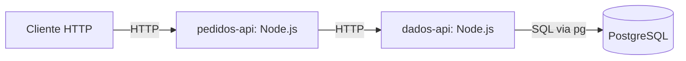
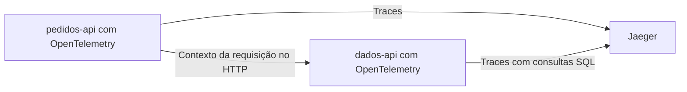
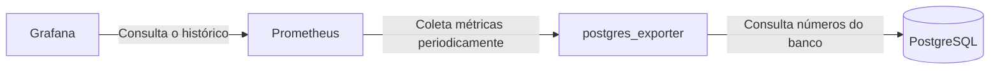

# Como o projeto vai funcionar

## Onde estamos e o que queremos mostrar

Este documento distingue o que existe do que vamos construir. A Etapa 1 preparou pastas e documentação; a Etapa 2 implementa o PostgreSQL, o modelo e a carga inicial. As APIs e a observabilidade abaixo ainda são planejadas. Queremos mostrar o problema N+1 com consultas reais ao PostgreSQL e comparar o resultado com uma consulta usando JOIN.

## O caminho de uma requisição

A resposta volta pelo caminho inverso. Cada API será um serviço separado, com seu próprio processo. Elas vão conversar por HTTP, o que nos permitirá acompanhar uma requisição passando de um serviço para o outro.

| Parte | Responsabilidade atual ou planejada |
| --- | --- |
| pedidos-api | Receber a requisição pública, chamar a dados-api e devolver a resposta. |
| dados-api | Fazer as consultas SQL com `pg` e devolver os dados à pedidos-api. |
| PostgreSQL | Já guarda clientes e pedidos; as consultas das duas versões virão na Etapa 4. |
| OpenTelemetry | Registrar as operações e levar as informações que ligam uma chamada à outra. |
| Jaeger | Receber e mostrar o percurso das requisições, chamado de trace. |
| postgres_exporter | Consultar o PostgreSQL e disponibilizar seus números para coleta. |
| Prometheus | Coletar esses números e guardar seu histórico. |
| Grafana | Buscar os dados no Prometheus e mostrá-los em painéis. |
| pg_stat_statements | Reunir estatísticas das consultas executadas no PostgreSQL. |
| Docker Compose | Já executa somente o banco; os outros contêineres virão nas etapas seguintes. |

Somente a `dados-api` acessará o banco. Na Etapa 3, vamos definir portas, rotas internas, limites de espera por resposta e como lidar com falhas de comunicação.

## As versões lenta e otimizada

A `pedidos-api` terá duas rotas públicas:

- `GET /pedidos/lento?limit=100`: a dados-api busca os pedidos e depois consulta o cliente de cada pedido. Com N pedidos, isso gera 1 + N consultas SQL.
- `GET /pedidos/otimizado?limit=100`: a dados-api busca os mesmos pedidos e seus clientes com uma consulta usando JOIN, que combina dados de tabelas relacionadas.

Cada rota poderá chamar a dados-api uma vez para escolher a busca desejada. As consultas repetidas acontecerão dentro da dados-api, no acesso ao banco.

As duas versões deverão retornar os mesmos registros, na mesma ordem e com o mesmo formato JSON. Na Etapa 4, vamos definir esse formato, as regras do limite de pedidos e a ordenação.

A comparação usará o mesmo limite, os mesmos dados e condições equivalentes. Não haverá esperas artificiais. O tempo de resposta dependerá do trabalho real e do ambiente; só saberemos a diferença depois de medir.

## Traces: acompanhando uma requisição

Um **trace distribuído** mostra o caminho de uma requisição entre as partes do sistema. Cada operação desse caminho, como uma chamada HTTP ou consulta SQL, é chamada de **span**.

O OpenTelemetry deverá permitir reunir as chamadas dos dois serviços e as consultas feitas com `pg` no mesmo trace. No Jaeger, poderemos ver as consultas repetidas da versão lenta e a consulta com JOIN da otimizada.

Na Etapa 5, vamos escolher as versões e a forma de enviar esses registros. A pasta `observability/otel/` guardará os arquivos dessa configuração. Sua existência não significa que usaremos um OpenTelemetry Collector separado, um componente opcional para receber e encaminhar esses registros.

## Métricas: acompanhando os números do banco

Uma **métrica** é um número acompanhado ao longo do tempo, como a quantidade de conexões abertas. Essa coleta acontecerá separadamente das requisições da aplicação.

O Prometheus buscará periodicamente as métricas disponibilizadas pelo exporter. O Grafana usará esse histórico para montar os painéis. Na Etapa 6, vamos escolher os números úteis ao experimento, os intervalos de coleta e os painéis.

## Estatísticas das consultas

O `pg_stat_statements` será habilitado no PostgreSQL para acompanhar, por exemplo, quantas vezes uma consulta foi executada e quanto tempo levou. Ele pode agrupar consultas com a mesma estrutura, mesmo quando os valores usados na busca mudam.

Essas estatísticas ajudam a entender o conjunto de consultas executadas. Já os traces ajudam a acompanhar uma requisição específica. Na Etapa 6, vamos verificar quais estatísticas o exporter consegue fornecer e quais precisaremos consultar diretamente.

## Dados e execução

O banco implementado tem duas tabelas:

| Tabela | Campos |
| --- | --- |
| `clients` | `id integer` por identidade e chave primária, `name text`, `created_at timestamptz` |
| `orders` | `id integer` por identidade e chave primária, `client_id integer`, `description text`, `amount numeric(12,2)`, `created_at timestamptz` |

Todos os campos são obrigatórios. A chave estrangeira de `orders.client_id` referencia `clients.id`, impede pedidos sem cliente e bloqueia a exclusão de clientes com pedidos. Há um índice em `orders.client_id`. `amount` não aceita números negativos. Não existem outras entidades ou regras de negócio nesta etapa.

O Compose executa `postgres:18.6-alpine`, publica somente `127.0.0.1:${POSTGRES_PORT:-5432}` e mantém um volume por projeto montado em `/var/lib/postgresql`. A senha precisa ser configurada localmente; banco e usuário administrativo são `observability` e `postgres`. Isso prepara um ambiente didático local, não uma configuração de produção ou credenciais para as futuras APIs.

Na primeira inicialização, `database/init/00-init.sh` valida as quantidades e chama o `psql` com `ON_ERROR_STOP` e `--single-transaction` para executar modelo e carga juntos. A transação protege tabelas e registros da aplicação; a criação do diretório do PostgreSQL pela imagem ocorre antes dela. Por isso, um volume cuja inicialização falhou não deve ser reaproveitado como carga válida.

A geração usa SQL, sem bibliotecas externas ou aleatoriedade. O padrão é 1.000 clientes e 10.000 pedidos; nomes, descrições, datas UTC e valores são calculados de maneira fixa. Os pedidos são distribuídos circularmente entre os clientes. Aceitamos ao menos um cliente e zero pedidos. A distribuição simples ajuda a repetir o experimento, mas não simula uma carga comercial real.

Reiniciar preserva os dados. Para gerar outra carga, usa-se outro nome de projeto Compose e outra porta, mantendo o volume anterior. Os comandos de execução, validação e encerramento estão no [README](../README.md). Não há recarga destrutiva nem mecanismo de evolução de esquema nesta etapa.

O ambiente completo usará Docker Compose nas próximas etapas. Versões e configurações das APIs e da observabilidade ainda serão escolhidas.

O [plano de implementação](plano-implementacao.md) mostra o que será feito e conferido em cada etapa.
